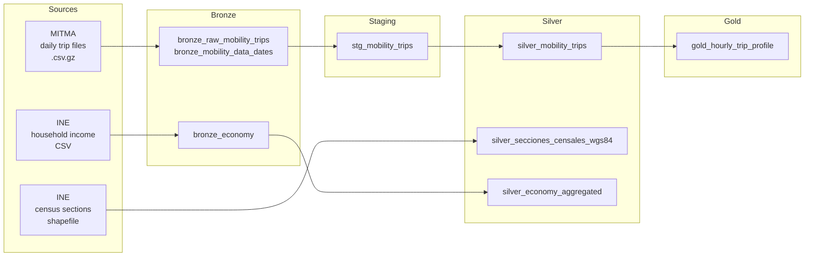

# Spain Mobility Lakehouse

A local **lakehouse** built with [DuckDB](https://duckdb.org) and [DuckLake](https://ducklake.select) that ingests, cleans and models the open mobility data published by Spain's Ministry of Transport (**MITMA**). The data covers **~6.5 billion trip records for 2023**. The pipeline joins them with **INE** census geography and household income data.

The goal is to analyse how people move across Spain (hourly patterns, weekdays vs. weekends and holidays) and how mobility relates to income. Everything runs on a single machine, with no cluster or cloud warehouse.

## Architecture



| Layer | Table | Description |
|---|---|---|
| Bronze | `bronze_raw_mobility_trips` | Raw MITMA rows exactly as published, plus an ingestion timestamp |
| Bronze | `bronze_mobility_data_dates` | Calendar of the year with a `has_data` flag (detects missing days) |
| Bronze | `bronze_economy` | INE income atlas, all columns as text |
| Staging | `stg_mobility_trips` | Data-quality rules applied (outliers, foreign zones, zone codes) |
| Silver | `silver_mobility_trips` | Hourly origin → destination trips, loaded incrementally per day |
| Silver | `silver_secciones_censales_wgs84` | Census section polygons reprojected from EPSG:25830 to WGS84, with centroids |
| Silver | `silver_economy_aggregated` | Average income per census section and year |
| Gold | `gold_hourly_trip_profile` | Share of daily trips per hour for weekdays, weekends, holidays and bridge days |

## Key design decisions

- **DuckLake as table format.** Data is stored as Parquet files and managed by a SQL catalog, which gives snapshots and ACID transactions without a server.
- **Bronze is immutable.** Cleaning happens in a staging table, so any rule can be changed and re-applied without downloading the data again.
- **Idempotent daily loads.** `silver_mobility_trips` is loaded one day at a time with a *delete + insert* pattern, so any date range can be re-processed safely, the same way an orchestrator (Airflow, Prefect) would run one task per day.
- **Source availability is tracked.** Before downloading, the pipeline checks which daily files exist and records missing days in `bronze_mobility_data_dates`.

## Data quality

The checks are documented in [`notebooks/data_quality_check.ipynb`](notebooks/data_quality_check.ipynb), and the resulting rules are applied by [`pipeline/staging_mobility.py`](pipeline/staging_mobility.py):

| Check | Finding | Action |
|---|---|---|
| Completeness | ~1.7 B rows with unknown age (`NA`), no null or zero trip counts | Age column not used downstream |
| Duplicates | Several rows per (date, hour, origin, destination), one per demographic segment | Aggregated in silver |
| Outliers | 83,642 records more than 10σ from their origin-destination mean (January sample) | Removed |
| Validity | Hours within 0–23, dates within 2023, no negative trips | ✔ |
| Referential integrity | 3,857 zones didn't match INE codes (Portugal, France, `externo`, `_AM`/`_AD` suffixes) | Foreign zones removed, suffixes stripped; 0 unmatched afterwards |

## Project structure

```
├── pipeline/
│   ├── db.py                    # Connection helper (attaches the DuckLake catalog)
│   ├── bronze_mobility.py       # Download MITMA daily files for a year
│   ├── bronze_economy.py        # Load INE income CSV
│   ├── staging_mobility.py      # Apply data-quality rules
│   ├── silver_mobility.py       # Incremental, idempotent daily load
│   ├── silver_geometry.py       # Census sections + reprojection (spatial extension)
│   ├── silver_economy.py        # Parse and aggregate income
│   └── gold_hourly_patterns.py  # Hourly profile by type of day
├── notebooks/
│   └── data_quality_check.ipynb # Data exploration and quality checks
└── requirements.txt
```

## How to run

```bash
python -m venv .venv && source .venv/bin/activate
pip install -r requirements.txt

# Bronze
python -m pipeline.bronze_mobility --year 2023
python -m pipeline.bronze_economy path/to/ine_renta.csv

# Staging and silver
python -m pipeline.silver_geometry path/to/SECC_CE_20230101.shp
python -m pipeline.staging_mobility
python -m pipeline.silver_mobility --start 2023-01-01 --end 2023-12-31
python -m pipeline.silver_economy

# Gold
python -m pipeline.gold_hourly_patterns
```

By default the lakehouse is created in `./my_ducklake.ducklake`. Set `LAKEHOUSE_URI` to use another location, or point it to a plain DuckDB file (`LAKEHOUSE_URI=dev.duckdb`) for quick experiments.

> **Note:** a full year of MITMA data is billions of rows. Start with a short date range if you're on a laptop.

## Data sources

- **MITMA**, *Estudio de movilidad con Big Data*: daily trips between districts. [movilidad-opendata.mitma.es](https://movilidad-opendata.mitma.es)
- **INE**, census section boundaries (*secciones censales*). [ine.es](https://www.ine.es)
- **INE**, *Atlas de distribución de renta de los hogares* (household income). [ine.es](https://www.ine.es)

## Tech stack

Python · DuckDB · DuckLake · DuckDB Spatial · SQL · pandas · Jupyter
